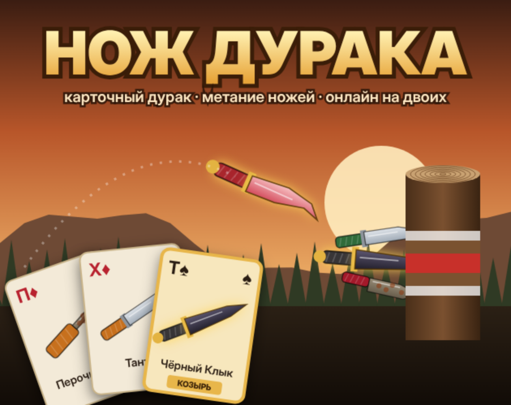
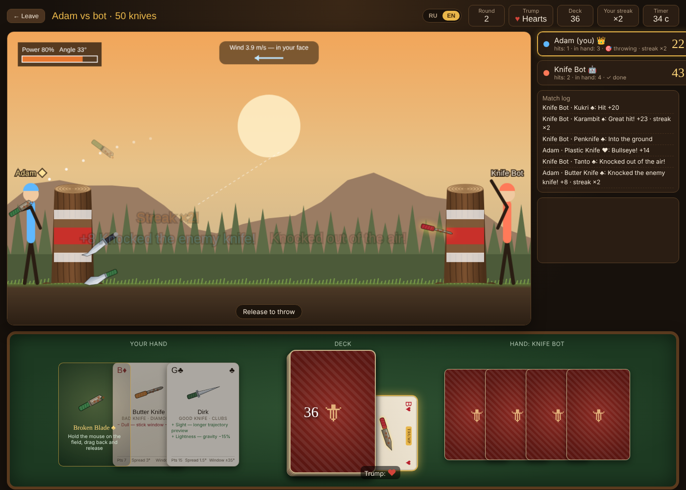
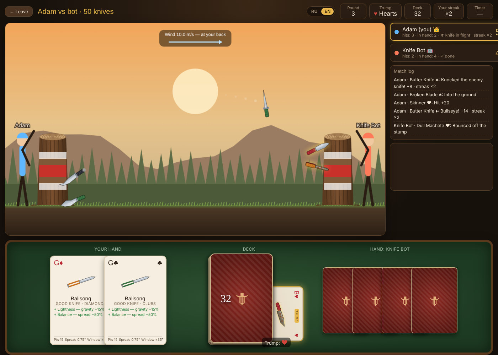
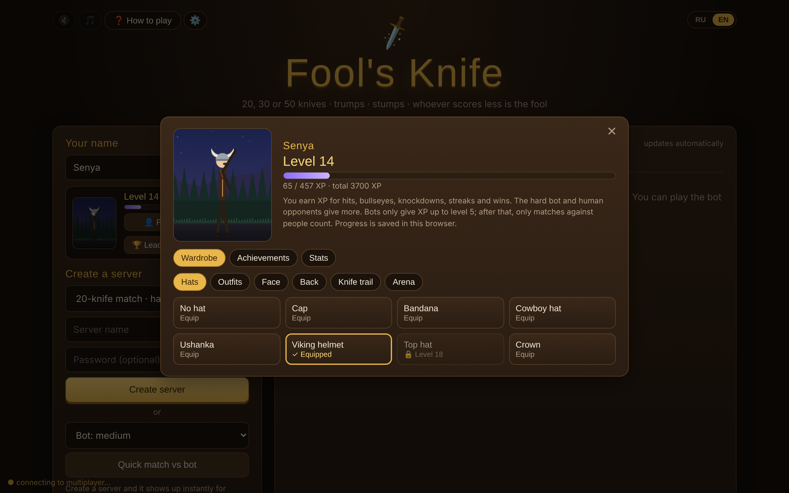
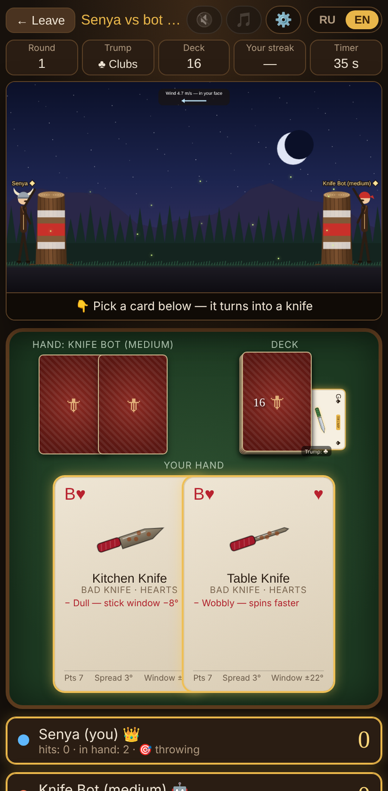
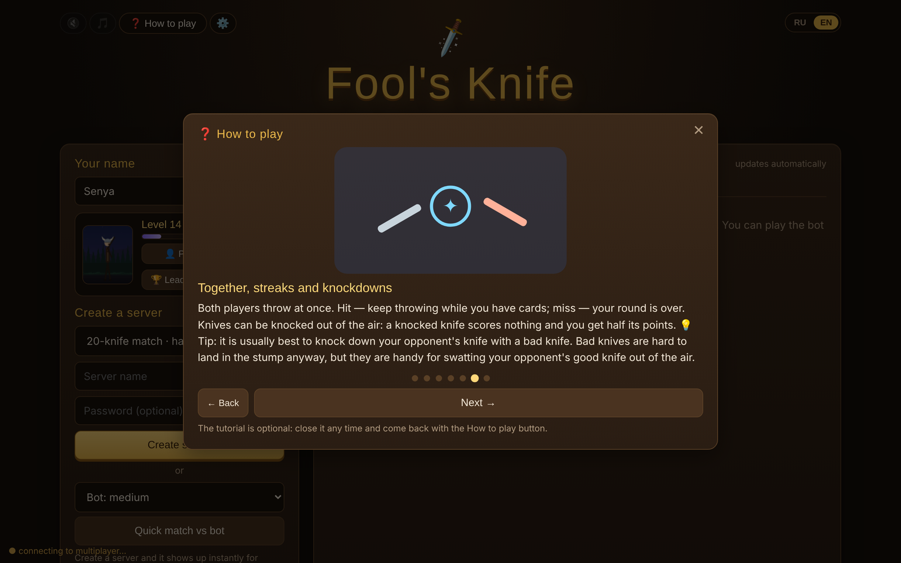

<p align="center"></p>

<h1 align="center">Fool's Knife</h1>

<p align="center">
  <b>The Russian card game Durak — except every card is a throwing knife.</b><br>
  Two-player browser game · online lobby with no game server · levels and outfits · phone and PC · RU / EN
</p>

<p align="center">
  <a href="https://adamjimmi.github.io/fools-knife/play/"><b>▶ Play in browser</b></a> ·
  <a href="https://adamjimmi.github.io/fools-knife/">Portfolio page</a> ·
  <a href="https://mor-game-studio.itch.io/fools-knife">itch.io</a> ·
  <a href="README.ru.md">Читать на русском</a>
</p>

---

## About

Each player draws cards from a shared deck. Pick a card and it turns into the knife drawn on it. Hold the mouse, drag back, release, and stick the knife into your opponent's stump. Both players throw **at the same time**. Hit and you throw again, miss and your round is over. Knives that meet in mid-air knock each other down. When every knife has been thrown, the higher score wins and the other player is the fool.

<p align="center">
  
  
</p>
<p align="center">
  
  
  
</p>

## Features

- **Cards become knives.** 28 unique knives across 4 suits, each with its own ballistics, abilities (homing, double strike, thief, magnet, ricochet…), qualities and flaws.
- **Trump suit.** As in Durak, the bottom card of the deck sets the trump. Trump knives gain an extra ability and quality and resist the wind.
- **Three match lengths.** 20, 30 or 50 knives, with a hand of 2, 3 or 5 cards.
- **Simultaneous throws and streaks.** Hit the stump to keep throwing. You can chain five hits in a 50-knife match.
- **Mid-air knockdowns.** Intercept a flying enemy knife: it scores nothing and you take half its points.
- **Online lobby.** Create a server, optionally with a password, and it appears instantly for every player. No accounts.
- **Three bot difficulties.** Easy, medium and hard, with simulated hit rates of about 28%, 62% and 87%. Bots give XP only up to level 5.
- **Levels and outfits.** 30 levels and 11 achievements. Earn XP for hits, bullseyes, knockdowns and wins, then unlock hats, outfits, faces, capes, knife trails and the night, winter and desert arenas. Progress is stored locally in the browser.
- **Leaderboard.** Top-100 by level in its own window. Players of the browser version share it through the same MQTT channel as the lobby.
- **Music and sound.** Five procedurally generated music tracks that follow the arena and crossfade smoothly, quiet sound effects, and separate master, music and effects volume sliders. No audio files.
- **Adapts to the device.** The game detects phone, tablet or desktop and switches layout by itself: portrait phone view with the cards on top, touch hints and vibration on hits.
- **Optional tutorial.** A seven-step guide plus a practice match against the easy bot with hints. It sits behind a button in the menu and is never forced.
- **Russian and English** UI with live switching. Each player sees the match log in their own language.

## How it works

| Part | What it does |
|---|---|
| [`src/game.js`](src/game.js) | Decks, knife stats, deterministic ballistics (120 Hz fixed step, gravity, wind, spin, “stick window”), mid-air collisions, procedural knife drawing |
| [`src/engine.js`](src/engine.js) | Host-side match engine: rounds, hands, simultaneous throws, scoring on landing, streaks, bot AI |
| [`src/extras.js`](src/extras.js) | Procedural music and sound, player profile (XP, levels, achievements, wardrobe), character and arena drawing, particles and weather |
| [`src/app.js`](src/app.js) | UI, rendering, input, localisation, settings, leaderboard, tutorial, device detection, networking glue |
| [`src/mqttnet.js`](src/mqttnet.js) | Hand-written MQTT 3.1.1 client over WebSocket, plus a lobby/rooms layer with presence and a small retained key-value store for the leaderboard |
| [`tools/build.py`](tools/build.py) | Bundles everything into one self-contained `play/index.html` |

**Netcode.** The player who creates a server runs the match engine in their own browser tab, so the host is authoritative. Guests send only intents (take a card, throw at an angle and power). The host validates them, simulates the throw, scores it and broadcasts compact state. A throw is described by its angle, power, seed and wind, so every client replays the same flight locally without sending trajectories over the network.

**No game server.** Players find each other through free public MQTT brokers (HiveMQ, EMQX, Mosquitto), and the client falls back to the next broker automatically. The lobby is a set of retained messages. Each host registers a “last will” message, so its server disappears from the list when its tab closes.

**Audio.** There are no sound files. Music and effects are synthesised with the Web Audio API. A track is a small pattern of chords, bass, drums and melody, and switching tracks crossfades two gain-controlled voices.

**Resilience.** Knives in flight are mirrored into the periodic state broadcast. If the throw message is lost, the knife still appears from the next state update. Points are applied when a knife lands, so a knife that gets knocked down never scores.

## Run locally

No dependencies. Open `play/index.html` in a browser, or rebuild it from `src/`:

```bash
python3 tools/build.py
```

The bot works offline. Online play and the leaderboard need internet access to one of the public MQTT brokers.

The leaderboard is a convenience feature rather than a secure one: entries are published by clients to a public broker, so a production release should move matches and rankings to its own server.

## Credits

Game design: **Adamjimmi / MOR. Game Studio**.
Built with plain JavaScript and Canvas 2D.

© 2026 Adamjimmi. All rights reserved.
