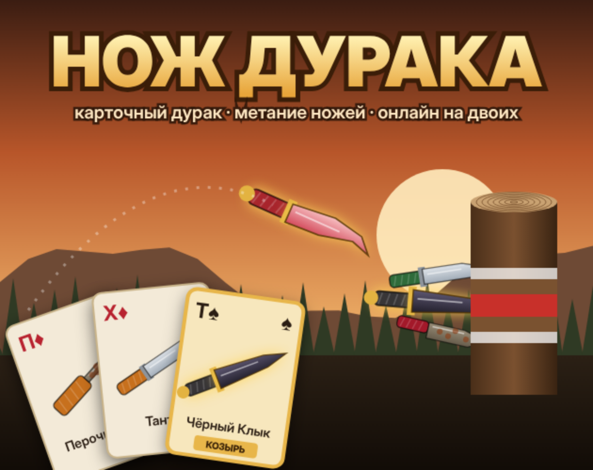
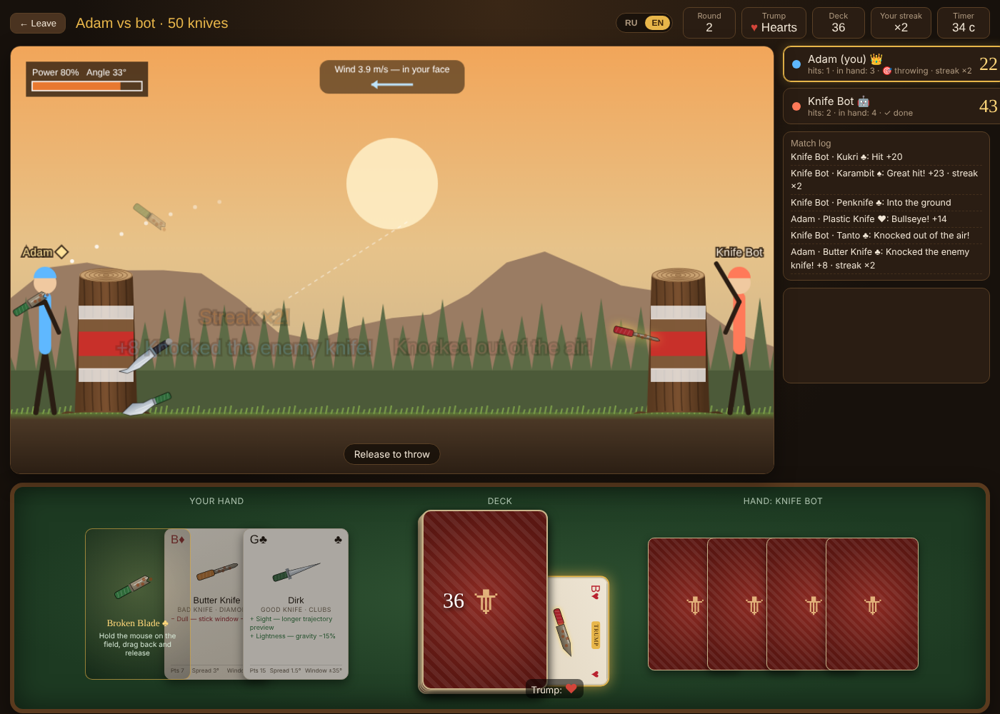
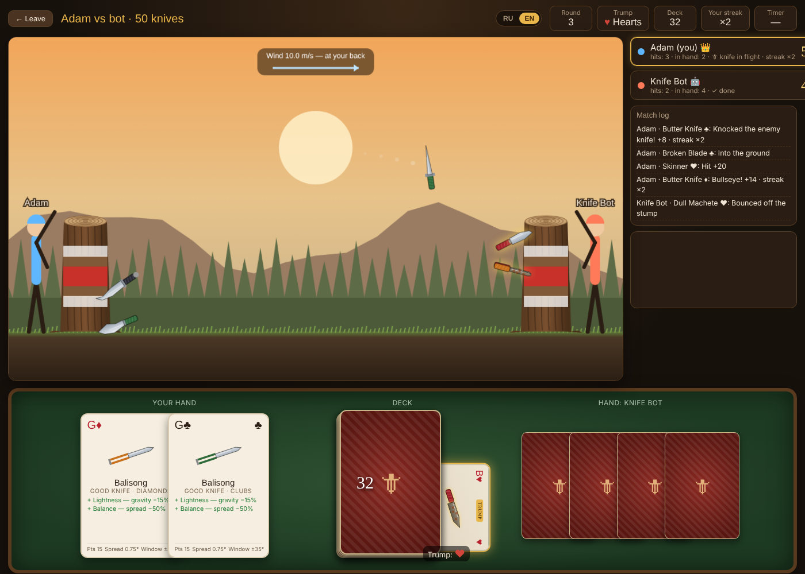

<p align="center"></p>

<h1 align="center">Нож дурака</h1>

<p align="center">
  <b>Карточный дурак, в котором каждая карта — метательный нож.</b><br>
  Браузерная игра на двоих · онлайн-лобби без игрового сервера · RU / EN
</p>

<p align="center">
  <a href="https://adamjimmi.github.io/fools-knife/play/"><b>▶ Играть в браузере</b></a> ·
  <a href="https://adamjimmi.github.io/fools-knife/">Страница-портфолио</a> ·
  <a href="https://mor-game-studio.itch.io/fools-knife">itch.io</a> ·
  <a href="README.md">English</a>
</p>

---

## Об игре

Игроки берут карты из общей колоды. Выбранная карта превращается в нож, который на ней нарисован. Зажми мышь, потяни назад, отпусти — и нож летит в пень соперника. Оба бросают **одновременно**. Попал — бросаешь ещё, промахнулся — твой раунд окончен. Ножи, встретившиеся в воздухе, сбивают друг друга. Когда все ножи брошены, побеждает тот, у кого больше очков, а второй игрок остаётся дураком.

<p align="center">
  
  
</p>

## Особенности

- **Карты становятся ножами.** 28 уникальных ножей четырёх мастей. У каждого своя баллистика, способности (самонаведение, двойной удар, вор, магнит, рикошет…), качества и недостатки.
- **Козырь.** Как в дураке, нижняя карта колоды задаёт козырную масть. Козырные ножи получают дополнительную способность и качество и почти не боятся ветра.
- **Три длины матча.** 20, 30 или 50 ножей, в руке 2, 3 или 5 карт.
- **Одновременные броски и серии.** Попал — бросаешь дальше. В матче на 50 ножей можно сделать серию из пяти попаданий.
- **Сбивание в воздухе.** Перехвати летящий нож соперника: он не принесёт очков, а ты получишь половину его стоимости.
- **Онлайн-лобби.** Создай сервер (можно с паролем), и он сразу появится в списке у всех. Без аккаунтов.
- **Бот** для тренировки без интернета.
- **Русский и английский** интерфейс с переключением на лету. Каждый игрок видит ход матча на своём языке.

## Как устроено

| Файл | Что делает |
|---|---|
| [`src/game.js`](src/game.js) | Колоды, характеристики ножей, детерминированная баллистика (шаг 120 Гц, гравитация, ветер, вращение, «окно втыкания»), столкновения в воздухе, процедурная отрисовка ножей |
| [`src/engine.js`](src/engine.js) | Движок матча на стороне хоста: раунды, руки, одновременные броски, очки при приземлении, серии, бот |
| [`src/app.js`](src/app.js) | Интерфейс, отрисовка, управление, локализация, сеть |
| [`src/mqttnet.js`](src/mqttnet.js) | Собственный MQTT 3.1.1-клиент поверх WebSocket и слой лобби и комнат |
| [`tools/build.py`](tools/build.py) | Собирает всё в один самодостаточный `play/index.html` |

**Сеть.** Тот, кто создал сервер, запускает движок матча у себя во вкладке, и решения принимает хост. Гости отправляют только намерения: взять карту, бросить с таким-то углом и силой. Хост проверяет их, симулирует бросок, считает очки и рассылает компактное состояние. Бросок описывается углом, силой, сидом и ветром, поэтому каждый клиент воспроизводит одинаковый полёт сам, и траектории по сети не передаются.

**Без игрового сервера.** Игроки находят друг друга через бесплатные публичные MQTT-брокеры (HiveMQ, EMQX, Mosquitto), и клиент сам переключается на следующий, если брокер недоступен. Лобби — это набор закреплённых сообщений. Хост оставляет «последнюю волю», поэтому его сервер пропадает из списка, когда вкладка закрыта.

**Надёжность.** Летящие ножи дублируются в регулярной рассылке состояния. Если сообщение о броске потерялось, нож всё равно появится из следующего обновления. Очки начисляются при приземлении, поэтому сбитый нож никогда не засчитывается.

## Запуск

Зависимостей нет. Открой `play/index.html` в браузере или пересобери его из `src/`:

```bash
python3 tools/build.py
```

Бот работает без интернета. Для онлайна нужен доступ к одному из публичных MQTT-брокеров.

## Авторы

Геймдизайн: **Adamjimmi / MOR. Game Studio**.
Чистый JavaScript и Canvas 2D.

© 2026 Adamjimmi. Все права защищены.
